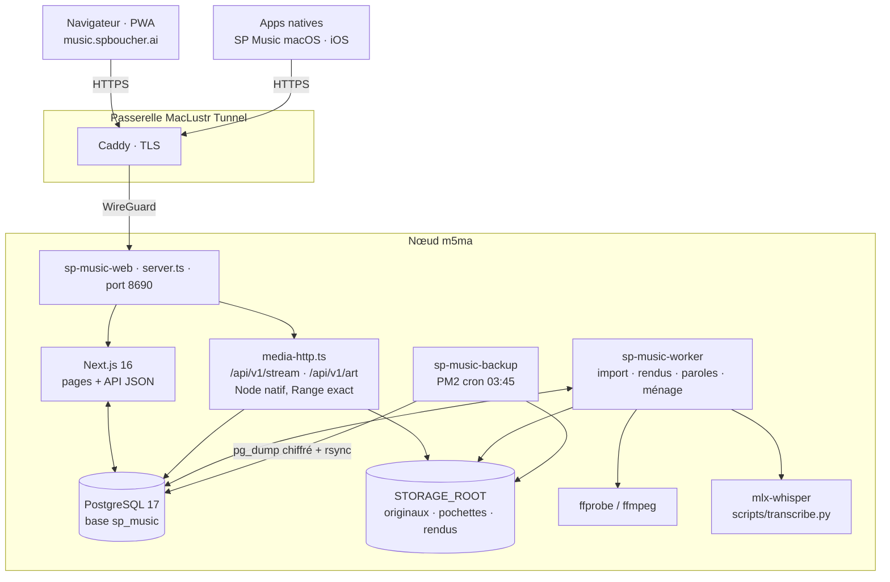
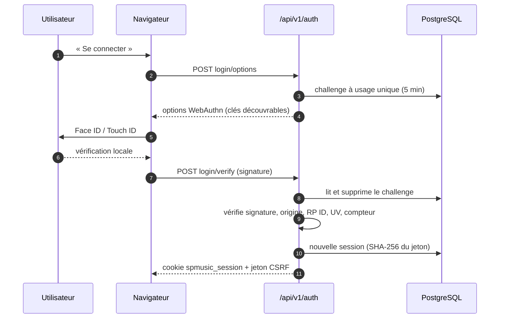
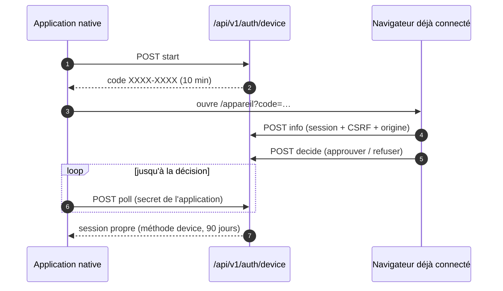
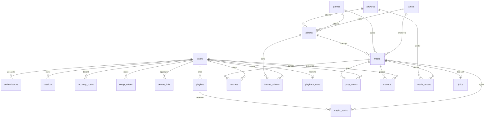

<div align="center">


<br><br>


# Music SP

**Lecteur musical privé : la bibliothèque audio personnelle de son propriétaire, hébergée sur son propre cluster, protégée par des clés d'accès, diffusée en HTTP Range et accompagnée de paroles synchronisées mot à mot.**

**Author: [Simon-Pierre Boucher](https://www.spboucher.ai)**

[](https://music.spboucher.ai)


[](https://git.spboucher.ai/sp-music/commits)
[](https://git.spboucher.ai/sp-music/commits)
[](https://git.spboucher.ai/sp-music/insights)
[](https://git.spboucher.ai/sp-music)
[](https://git.spboucher.ai/sp-music/insights)
[](https://git.spboucher.ai/sp-music)
[](https://git.spboucher.ai/sp-music/branches)
[](https://git.spboucher.ai/sp-music/tags)
[](https://git.spboucher.ai/sp-music)


</div>

---

## Sommaire

- [Vue d'ensemble](#-vue-densemble)
- [Fonctionnalités](#-fonctionnalités)
- [Architecture](#-architecture)
- [Pile technique](#-pile-technique)
- [Arborescence du dépôt](#-arborescence-du-dépôt)
- [Démarrage local](#-démarrage-local)
- [Configuration](#-configuration)
- [Pages](#-pages)
- [API](#-api)
- [Pipeline d'import](#-pipeline-dimport)
- [Diffusion audio](#-diffusion-audio)
- [Paroles synchronisées (karaoké)](#-paroles-synchronisées-karaoké)
- [Clients natifs](#-clients-natifs)
- [Modèle de données](#-modèle-de-données)
- [Sécurité et vie privée](#-sécurité-et-vie-privée)
- [Vérifications et tests](#-vérifications-et-tests)
- [Déploiement et exploitation](#-déploiement-et-exploitation)
- [Sauvegarde et restauration](#-sauvegarde-et-restauration)
- [Dépannage et pièges connus](#-dépannage-et-pièges-connus)
- [Limites connues](#-limites-connues)
- [Documentation](#-documentation)
- [Auteur](#-auteur)
- [Licence](#-licence)

---

## 🎯 Vue d'ensemble

Music SP est un **lecteur musical privé** : il lit la bibliothèque audio personnelle de son propriétaire, hébergée
sur son cluster. Production : **https://music.spboucher.ai**.

Ce n'est **pas un service de catalogue** : la bibliothèque ne contient que des fichiers téléversés par un
administrateur (achats numériques, CD personnels numérisés, créations, licences appropriées). Rien n'est extrait d'un
service de streaming.

- **Écoute** — accueil, recherche, pages album / artiste, file d'attente, favoris, listes de lecture, reprise de
  lecture par compte, paroles synchronisées, PWA installable.
- **Administration** — import par glisser-déposer avec reprise, détection des doublons, correction des tags,
  pochettes, comptes, santé du système, journal d'audit.
- **Accès** — clés d'accès WebAuthn uniquement (Face ID / Touch ID / code de l'appareil). Aucun mot de passe, aucune
  inscription publique. Deux rôles : administrateur et auditeur.

### Famille SP Music

| Dépôt | Plateforme | Rôle |
|---|---|---|
| **[sp-music](https://git.spboucher.ai/sp-music)** (ce dépôt) | Web · PWA | Serveur : site, API `/api/v1`, worker d'import, diffusion audio, paroles |
| [sp-music-macos](https://git.spboucher.ai/sp-music-macos) | macOS | Client natif : copie locale du catalogue, lecture hors ligne |
| [sp-music-ios](https://git.spboucher.ai/sp-music-ios) | iOS · iPadOS | Client natif : même API, lecture hors ligne |

Les deux applications natives utilisent les mêmes surfaces d'API que le site, plus la synchronisation incrémentale,
l'association d'appareil et l'historique d'écoute décrits dans [Clients natifs](#-clients-natifs).

## ✨ Fonctionnalités

| Domaine | Ce que fait le code |
|---|---|
| Écoute | accueil, recherche (titre, artiste, album, genre — index trigrammes), pages album et artiste, bibliothèque triable |
| Lecteur | file d'attente modifiable, « À suivre », aléatoire, répétition, écran « En cours de lecture », commandes média du système ; le lecteur vit dans le layout et survit à la navigation |
| Compte | favoris (pistes et albums), listes de lecture ordonnables, reprise de lecture par compte, langue et couleur d'accent (6 accents : `ember`, `violet`, `ocean`, `forest`, `rose`, `gold`) |
| Paroles | vue karaoké : transcription locale Whisper avec horodatage par mot, correction ligne par ligne par un administrateur |
| Import (`/admin`) | glisser-déposer de fichiers, dossiers ou ZIP ; envoi par morceaux avec reprise ; validation sur les octets ; doublons ; remplacement confirmé et journalisé |
| Bibliothèque (`/admin`) | correction des tags et de l'ordre des pistes, pochettes, réanalyse, suppression auditée |
| Comptes (`/admin`) | invitation par lien à usage unique, rôles, suspension, révocation des sessions |
| Système (`/admin`) | santé (base, stockage, worker), dernière sauvegarde, journal d'audit |
| Accès | clés d'accès WebAuthn seulement, huit codes de récupération, sessions révocables, CSRF, limitation de débit |
| Formats | FLAC, MP3, AAC / M4A, WAV, ALAC, AIFF, Ogg, DSD (DSF / DFF) — l'original est toujours conservé |
| Clients natifs | catalogue incrémental par révisions, association d'appareil par code court, historique d'écoute, fichier `apple-app-site-association` |
| PWA | manifeste et icônes (installable sur l'écran d'accueil ; en ligne seulement) |
| Langues | français (défaut) et anglais — 449 chaînes, une ligne par chaîne dans `src/i18n/messages.ts` |

## 🏗 Architecture



### Séparation des responsabilités

1. **Interface et lecteur** — `src/app`, `src/components`.
2. **API** — quatre surfaces, une route attrape-tout chacune ; le garde s'exécute *avant* la recherche du
   gestionnaire (`src/lib/api/router.ts`). Un gestionnaire d'administration ne peut pas être atteint sans le contrôle
   de rôle : il n'est même pas recherché avant.
3. **Métadonnées** — PostgreSQL. La base ne contient que des métadonnées et des clés de stockage.
4. **Originaux** — `STORAGE_ROOT/originals/<aa>/<sha256>.<ext>`, jamais modifiés, jamais sous `public/`.
5. **Pochettes et rendus** — `art/<aa>/<sha256>/{orig.*,96.jpg,320.jpg,640.jpg}`, `renditions/<aa>/<track>.m4a`.
6. **Traitement asynchrone** — `src/worker/index.ts` ; la file est la table `uploads` elle-même
   (`FOR UPDATE SKIP LOCKED`) : rien n'est perdu à un redémarrage.

### Connexion par clé d'accès



## 🧱 Pile technique

| Couche | Technologie | Version | Rôle |
|---|---|---|---|
| Interface + API | Next.js (App Router) | 16.4.6 | pages et API JSON |
| UI | React · React DOM | 19.3.1 | composants, lecteur persistant |
| Styles | Tailwind CSS (`@tailwindcss/postcss`) | 4.3.5 | thème, accents |
| Langage | TypeScript | 6.0.3 | tout le code applicatif |
| Processus web | `server.ts` (HTTP Node via `tsx` 4.23.15) | — | sert l'audio et les pochettes nativement (Range, `Content-Length` exacts) et délègue le reste à Next |
| Métadonnées | PostgreSQL + `postgres` | 17 · 4.1.0 | `db/migrations/*.sql`, appliquées une fois, sommes de contrôle |
| Fichiers | volume privé du nœud (`STORAGE_ROOT`) | — | derrière l'interface `Storage` (`src/server/storage.ts`) |
| Traitement asynchrone | worker `tsx` | — | la file est la table `uploads` |
| Audio | `ffprobe` / `ffmpeg` | Homebrew | appelés avec un vecteur d'arguments (jamais de shell) |
| Paroles | `mlx-whisper`, modèle `mlx-community/whisper-large-v3-turbo` | — | transcription locale, horodatage par mot |
| WebAuthn | `@simplewebauthn/server` · `@simplewebauthn/browser` | 14.1.0 · ^14.0.0 | clés d'accès |
| Validation | Zod | 4.6.7 | schémas stricts de chaque corps de requête |
| Archives | yauzl | 3.2.0 | lecture des ZIP |
| Tests | Vitest | 5.1.0 | tests HTTP sur un build de production |
| Lint | ESLint + `eslint-config-next` | 10.14.0 · 16.4.6 | `src scripts tests server.ts` |
| Orchestration | PM2 via `mld` (MacLustr) | — | HTTPS par Caddy sur la passerelle du MacLustr Tunnel |

Versions lues dans `package.json` (plancher des plages `^`).

## 🗂 Arborescence du dépôt

```
sp-music/
├── server.ts                    processus web : HTTP Node → media-http, sinon Next.js
├── next.config.ts               CSP statique, en-têtes de sécurité, compress: false
├── db/migrations/
│   ├── 001_init.sql             comptes, clés d'accès, sessions, catalogue, imports, listes, favoris
│   ├── 002_lyrics.sql           paroles synchronisées
│   └── 003_native_clients.sql   révisions, pierres tombales, association d'appareil, historique
├── src/
│   ├── app/
│   │   ├── (app)/               accueil, bibliothèque, recherche, album, artiste, favoris, listes, compte, admin
│   │   ├── (auth)/              login, setup, appareil
│   │   └── api/                 health + 4 routes attrape-tout /api/v1/{auth,library,me,admin}
│   ├── components/              lecteur (player, player-ui, lyrics-view), shell, admin/*, auth-forms
│   ├── i18n/                    messages.ts : [français, English]
│   ├── lib/
│   │   ├── api/                 router.ts (garde avant gestionnaire), schemas.ts, *routes.ts
│   │   └── …                    auth, session, session-store, crypto, ratelimit, audit, env, db, http
│   ├── server/                  catalog, ingest, media, media-http, range, storage, lyrics, sync, admin
│   └── worker/index.ts          file d'import, rendus AAC, réanalyse, paroles, ménage, battement
├── scripts/
│   ├── migrate.ts               applique les migrations (transactionnelles, sommes de contrôle)
│   ├── bootstrap.ts             crée le propriétaire, écrit son lien d'inscription
│   ├── setup-token.ts           réémet un lien d'inscription (--recovery)
│   ├── import.ts                import côté serveur par le pipeline normal
│   ├── lyrics.ts                met des pistes en file pour la transcription
│   ├── transcribe.py            mlx-whisper, horodatage par mot
│   ├── rebuild-derived.ts       vérifie les originaux, refait miniatures et rendus
│   ├── backup.sh · restore.sh   sauvegarde chiffrée et restauration
│   ├── secrets-scan.ts          recherche de secrets dans le dépôt
│   └── test.sh                  suite d'intégration complète
├── tests/                       unit, api, restart + authentificateur WebAuthn logiciel (webauthn.ts)
├── public/                      icônes, manifeste PWA, robots.txt
└── docs/                        ARCHITECTURE.md · SECURITY.md · OPERATIONS.md · brand/
```

## 🚀 Démarrage local

Prérequis : Node.js, pnpm, PostgreSQL 17 (extensions `citext` et `pg_trgm`), `ffmpeg` + `ffprobe`.

```bash
pnpm install
createdb sp_music_dev
cp .env.example .env          # APP_URL=http://localhost:8690, DATABASE_URL, STORAGE_ROOT, APP_SECRET…
pnpm migrate && node_modules/.bin/tsx scripts/bootstrap.ts   # affiche le lien d'inscription du propriétaire
pnpm dev                      # http://localhost:8690  (localhost est un contexte sûr : les clés d'accès y fonctionnent)
pnpm worker                   # dans un second terminal
```

| Script `pnpm` | Commande | Rôle |
|---|---|---|
| `dev` | `tsx server.ts` | serveur de développement |
| `build` | `next build` | build de production |
| `start` | `NODE_ENV=production tsx server.ts` | serveur de production |
| `worker` | `tsx src/worker/index.ts` | worker d'arrière-plan |
| `migrate` | `tsx scripts/migrate.ts` | migrations |
| `typecheck` | `tsc --noEmit` | types |
| `lint` | `eslint src scripts tests server.ts` | lint |
| `test` | `bash scripts/test.sh` | suite d'intégration |
| `secrets:scan` | `tsx scripts/secrets-scan.ts` | recherche de secrets |

## ⚙️ Configuration

Tout passe par `.env` (jamais commité ; modèle : [`.env.example`](.env.example)). Noms seulement :

| Variable | Rôle | Défaut |
|---|---|---|
| `APP_URL` | origine publique exacte ; WebAuthn la compare octet pour octet | `http://localhost:8690` |
| `WEBAUTHN_RP_ID` | RP ID ; par défaut l'hôte de `APP_URL`. Le changer invalide toutes les clés inscrites | hôte de `APP_URL` |
| `APP_SECRET` | secret applicatif, 32 caractères au moins | requis |
| `PORT` · `HOST` | écoute du processus web | `8690` · `0.0.0.0` |
| `OWNER_EMAIL` · `OWNER_NAME` | premier administrateur créé par `scripts/bootstrap.ts` | — |
| `SETUP_URL_FILE` | fichier (0600) où est écrit le lien d'inscription du propriétaire | — |
| `DATABASE_URL` | PostgreSQL (métadonnées seulement) | requis |
| `STORAGE_DRIVER` | `local` (seul pilote livré) | `local` |
| `STORAGE_ROOT` | point de montage de la bibliothèque, hors du dossier de l'application | requis |
| `TMP_DIR` | espace de travail des envois en cours | `$STORAGE_ROOT/.tmp` |
| `UPLOAD_MAX_FILE_MB` | taille maximale d'un fichier | `2048` |
| `UPLOAD_MAX_CHUNK_MB` | taille maximale d'un corps de requête | `16` |
| `UPLOAD_MAX_FILES` | fichiers en cours simultanés (et fichiers audio par archive) | `500` |
| `LIBRARY_QUOTA_GB` | quota total de la bibliothèque ; `0` = aucun | `0` |
| `ARCHIVE_MAX_ENTRIES` · `ARCHIVE_MAX_TOTAL_MB` · `ARCHIVE_MAX_RATIO` | bornes des ZIP | `2000` · `20480` · `100` |
| `UPLOAD_RETENTION_DAYS` | purge des imports terminés ou abandonnés | `30` |
| `RENDITIONS` | `auto` (rendu AAC à l'import et à la demande) ou `never` | `auto` |
| `RENDITION_BITRATE_KBPS` | débit du rendu AAC | `256` |
| `TRANSCODE_DSD` | produire aussi un rendu lisible pour le DSD | `false` |
| `FFMPEG_PATH` · `FFPROBE_PATH` | chemins des binaires | `ffmpeg` · `ffprobe` |
| `LYRICS` | `off`, `manual` ou `auto` | `off` |
| `LYRICS_PYTHON` | Python d'un environnement virtuel avec `mlx-whisper` | — |
| `LYRICS_MODEL` | modèle Whisper | `mlx-community/whisper-large-v3-turbo` |
| `BACKUP_DIR` · `BACKUP_PASSPHRASE_FILE` · `BACKUP_TRASH_DAYS` | sauvegardes (`scripts/backup.sh`) | — · — · `30` |
| `APPLE_APP_IDS` | applications natives autorisées à utiliser les clés d'accès du site (`TeamID.bundleId`, séparées par des virgules) | SP Music macOS et iOS |

## 🧭 Pages

13 pages (`page.tsx`) : 10 dans l'application, 3 d'authentification.

| Route | Groupe | Contenu |
|---|---|---|
| `/` | app | accueil |
| `/bibliotheque` | app | albums, artistes, pistes |
| `/recherche` | app | recherche |
| `/album/[id]` · `/artiste/[id]` | app | fiches album et artiste |
| `/favoris` | app | favoris |
| `/listes` · `/listes/[id]` | app | listes de lecture |
| `/compte` | app | clés d'accès, sessions, préférences |
| `/admin` | app | import, bibliothèque, comptes, système |
| `/login` | auth | connexion par clé d'accès, code de récupération |
| `/setup` | auth | inscription par lien à usage unique |
| `/appareil` | auth | approbation d'une application native |

## 🔌 API

Préfixe `/api/v1`. Quatre surfaces, 73 routes JSON, plus trois routes servies nativement par `server.ts` et
`GET /api/health`.

| Surface | Garde | Routes | Contenu |
|---|---|---|---|
| `/api/v1/auth/*` | aucun (limité en débit par adresse) | 12 | session, options / vérification WebAuthn, code de récupération, association d'appareil, déconnexion |
| `/api/v1/library/*` | `requireUser` | 26 | catalogue, recherche, favoris, listes, état de lecture, synchronisation, historique, rendu AAC, paroles |
| `/api/v1/me/*` | `requireUser` | 8 | clés d'accès, sessions, préférences du compte, codes de récupération |
| `/api/v1/admin/*` | `requireAdmin` | 27 | import, édition, suppression, paroles, comptes, santé, journal |

<details>
<summary><b>auth — 12 routes</b></summary>

| Méthode | Chemin |
|---|---|
| GET | `session` |
| POST | `setup/info` |
| POST | `register/options` · `register/verify` |
| POST | `login/options` · `login/verify` |
| POST | `recovery` |
| POST | `device/start` · `device/poll` · `device/info` · `device/decide` |
| POST | `logout` |

</details>

<details>
<summary><b>library — 26 routes</b></summary>

| Méthode | Chemin | Notes |
|---|---|---|
| GET | `home` | accueil du compte |
| GET | `albums` · `albums/:id` | tri `recent`, `title`, `artist`, `year` |
| GET | `artists` · `artists/:id` | |
| GET | `tracks` · `tracks/:id` | tri `title`, `recent`, `artist` |
| GET | `search?q=` | 100 caractères au plus |
| GET | `favorites` | |
| PUT · DELETE | `favorites/:kind/:id` | `kind` = `track` ou `album` |
| GET · POST | `playlists` | |
| GET · PATCH · DELETE | `playlists/:id` | `baseUpdatedAt` facultatif → `409 conflict` |
| POST | `playlists/:id/tracks` | |
| PUT | `playlists/:id/order` | |
| GET | `sync?since=<rev>` · `sync/me` | clients natifs |
| GET · POST | `history` | historique d'écoute |
| GET · PUT | `playback` | état de lecture |
| POST | `tracks/:id/compat` | demande de rendu AAC |
| GET | `tracks/:id/lyrics` | |

</details>

<details>
<summary><b>me — 8 routes</b></summary>

| Méthode | Chemin |
|---|---|
| PATCH | `preferences` (langue `fr` / `en`, accent, nom affiché) |
| GET | `passkeys` |
| PATCH · DELETE | `passkeys/:id` |
| GET | `sessions` |
| DELETE | `sessions/:id` |
| POST | `sessions/revoke-others` |
| GET | `recovery-codes` |

</details>

<details>
<summary><b>admin — 27 routes</b></summary>

| Méthode | Chemin |
|---|---|
| GET | `uploads/limits` |
| GET · POST | `uploads` (filtre `all`, `active`, `error`, `duplicate`, `ready`) |
| GET · PATCH · DELETE | `uploads/:id` (`PATCH ?offset=N` = un morceau) |
| POST | `uploads/:id/retry` · `uploads/:id/replace` · `uploads/clear` |
| PATCH | `tracks` |
| POST | `tracks/delete` · `tracks/reanalyse` |
| PATCH | `albums/:id` |
| PUT | `albums/:id/order` · `albums/:id/artwork` |
| POST | `albums/:id/delete` |
| POST | `lyrics/generate` (langues `fr`, `en`, `es`, `it`, `de`, `pt`) |
| PUT · DELETE | `tracks/:id/lyrics` |
| GET · POST | `users` |
| PATCH · DELETE | `users/:id` |
| POST | `users/:id/invite` · `users/:id/revoke-sessions` |
| GET | `health` · `audit` |

Les suppressions de pistes et d'albums exigent `confirm: true` dans le corps.

</details>

**Routes natives (`src/server/media-http.ts`)**

| Méthode | Chemin | Rôle |
|---|---|---|
| GET · HEAD | `/api/v1/stream/<uuid piste>[?v=compat]` | audio, HTTP Range (206) |
| GET · HEAD | `/api/v1/art/<uuid pochette>[?s=96\|320\|640\|orig]` | pochettes |
| GET | `/.well-known/apple-app-site-association` | autorise les applications natives à utiliser les clés d'accès du site |

**Santé** : `GET /api/health` → `{ok, db, storage, worker}` (503 si la base ou le stockage ne répond pas ; le
worker est sain si son battement a moins de 120 s).

## 📥 Pipeline d'import

```
navigateur : POST /admin/uploads {nom, taille}  →  PATCH /admin/uploads/<id>?offset=N (morceaux de 8 Mo, écrits en flux)
uploading → received → validating → extracting → ready | duplicate | error | cancelled
```

- **Reprise** : un morceau envoyé au mauvais décalage reçoit `409` avec le décalage attendu ; le client reprend là.
- **Validation** : type déterminé par les premiers octets (`sniff`), jamais par l'extension ; puis `ffprobe` doit
  trouver un flux audio mesurable. Exécutables, textes, vidéos : refusés.
- **Doublons** : `same_file` (même SHA-256) ou `same_track` (même artiste d'album, album, disque, numéro, titre).
  Rien n'est remplacé sans confirmation explicite ; le remplacement garde l'identifiant de la piste (listes et
  favoris intacts) et est journalisé.
- **ZIP** : chaque entrée audio est écrite sous un nom généré par le serveur ; limites sur le nombre d'entrées, la
  taille par entrée, la taille totale et le taux de compression, mesurées sur les octets produits ; archives
  chiffrées, imbriquées ou contenant un chemin `../` : refusées.
- **Tags** : titre, artiste, album, artiste d'album, piste, disque, année, genre ; à défaut, le nom du fichier
  (« 03 Titre.wav »).
- **Pochette** : extraite du fichier sans réencodage, dédupliquée par empreinte ; miniatures carrées JPEG générées à
  part.
- **Reprise après panne** : un travail interrompu retourne dans la file (trois tentatives, puis une erreur visible).

**Import côté serveur** (administrateur avec accès shell au nœud, sans session) — même pipeline que l'interface :

```bash
node_modules/.bin/tsx scripts/import.ts <dossier> --wait
```

## 🎧 Diffusion audio

- `GET /api/v1/stream/<uuid>` exige la session ; `Range` → `206` avec `Content-Range` et `Content-Length` exacts ;
  `416` si la plage est hors fichier ; `ETag` = identifiant de l'asset, `Cache-Control: private, no-cache` (un
  fichier remplacé change d'asset, donc d'ETag).
- Lecture depuis le disque par `createReadStream({start, end})` : un morceau n'est jamais chargé en mémoire.
- **Original d'abord.** `tracks.web_playable` :

  | Valeur | Formats | Comportement |
  |---|---|---|
  | `yes` | FLAC, MP3, AAC, WAV | original servi tel quel |
  | `some` | ALAC, AIFF, Ogg | rendu AAC préparé à l'import |
  | `no` | DSD | original conservé, rendu seulement si `TRANSCODE_DSD=true` |

- Le lecteur choisit avec `canPlayType` ; si le navigateur échoue à décoder un original, il demande le rendu
  (`POST /library/tracks/<id>/compat`) et reprend à la même position.
- Aucun transcodage haute résolution : le rendu de compatibilité est un AAC (`RENDITION_BITRATE_KBPS`, 44,1 / 48 kHz).

**Stockage.** `src/server/storage.ts` définit `Storage` (`putFile`, `put`, `read(range)`, `size`, `delete`,
`localPath`, `health`). Seul le pilote `local` est livré : le cluster n'a pas de stockage objet. Un pilote S3
s'ajoute en implémentant cette interface (`localPath` devant alors télécharger vers un fichier temporaire pour
ffmpeg) ; `STORAGE_DRIVER=s3` échoue aujourd'hui explicitement plutôt que de faire semblant.

## 🎤 Paroles synchronisées (karaoké)

Les paroles sont transcrites **sur le nœud** à partir de l'audio (mlx-whisper, modèle `whisper-large-v3-turbo`),
avec un horodatage par mot ; rien n'est envoyé à un service externe et aucun site de paroles n'est interrogé.

```bash
uv venv ~/.venvs/whisper --python 3.12 && uv pip install -p ~/.venvs/whisper mlx-whisper     # une fois
# .env : LYRICS=auto (ou manual), LYRICS_PYTHON=$HOME/.venvs/whisper/bin/python
node_modules/.bin/tsx scripts/lyrics.ts --missing --wait            # toute la bibliothèque
node_modules/.bin/tsx scripts/lyrics.ts --album "Thriller" --lang en --overwrite
```

- `LYRICS=auto` met aussi en file chaque nouvel import ; `manual` laisse l'administrateur décider (`/admin` →
  Bibliothèque → sélection → Paroles).
- La transcription d'une voix chantée sur de la musique reste imparfaite (mots mal entendus, langue mal détectée
  quand une piste commence par une longue intro : préciser la langue). Chaque ligne se corrige dans `/admin` →
  Bibliothèque → icône Paroles de la piste ; une correction manuelle n'est jamais écrasée sans demande explicite.
- Une piste sans voix est marquée « instrumental ». Les phrases inventées par le modèle sur du silence
  (« Thank you », « Sous-titrage… ») sont filtrées (`src/server/lyrics.ts`).
- Les scores non finis renvoyés par Whisper sur les passages instrumentaux ne cassent plus la sortie JSON
  (`scripts/transcribe.py`, commit `b475a70`).

## 📱 Clients natifs

Les applications macOS et iOS gardent leur propre copie du catalogue et lisent hors ligne. Elles utilisent les mêmes
surfaces que le site, plus ceci (migration `003_native_clients.sql`) :

| Route | Rôle |
|---|---|
| `GET /api/v1/library/sync?since=<rev>` | Catalogue incrémental : artistes, albums, pistes dont la révision dépasse `since`, et pierres tombales des suppressions. Chaque piste porte son fichier (`assetId`, `sha256`, `sizeBytes`, `mime`) pour le téléchargement vérifié. `more: true` = redemander avec le `rev` reçu. |
| `GET /api/v1/library/sync/me` | Listes (avec leurs entrées), favoris et état de lecture du compte, en une réponse. |
| `GET` / `POST /api/v1/library/history` | Historique d'écoute ; l'identifiant de chaque événement vient du client (renvoi sans doublon). |
| `PATCH playlists/:id`, `PUT playlists/:id/order` | Champ facultatif `baseUpdatedAt` : `409 conflict` si la liste a changé depuis la copie du client (modification faite hors ligne). |
| `POST /api/v1/auth/device/{start,poll,info,decide}` | Association d'appareil. Page d'approbation : `/appareil`. |
| `GET /.well-known/apple-app-site-association` | Autorise les applications (`APPLE_APP_IDS`) à utiliser les clés d'accès du site. |

**Révisions.** `artists`, `albums` et `tracks` portent une colonne `rev` tirée d'une seule séquence par un
déclencheur ; un verrou consultatif de transaction est pris *avant* le tirage, donc les révisions sont validées dans
l'ordre croissant et la plus haute révision d'une réponse est un curseur sûr. Un changement de fichier
(`media_assets`) ou de paroles (`lyrics`) fait avancer la révision de la piste. La lecture se fait dans un seul
instantané (`REPEATABLE READ`).



## 🗃 Modèle de données

25 tables, 3 migrations (`db/migrations/`). Une migration appliquée n'est jamais modifiée (somme de contrôle
vérifiée) : on en ajoute une.

| Groupe | Tables |
|---|---|
| Comptes et accès | `users` (rôle `admin` / `listener`, un seul `is_owner`), `authenticators`, `sessions`, `setup_tokens`, `recovery_codes`, `webauthn_challenges`, `device_links` |
| Protection et journal | `rate_limits`, `audit_events`, `worker_heartbeat` |
| Catalogue | `artists`, `genres`, `albums`, `tracks`, `artworks`, `media_assets` (original, rendu, pochette, miniature), `lyrics`, `library_tombstones` |
| Import | `uploads` (import + file de traitement) |
| Données personnelles | `playlists`, `playlist_tracks`, `favorites`, `favorite_albums`, `playback_state`, `play_events` |

Contraintes notables : un seul original par piste ; un même fichier (SHA-256) ne peut pas être stocké deux fois ; un
album est unique par (artiste d'album, titre normalisé) ; index trigrammes pour la recherche.



## 🔐 Sécurité et vie privée

Détail complet : [`docs/SECURITY.md`](docs/SECURITY.md).

**Clés d'accès (WebAuthn)**

- **RP ID** : `music.spboucher.ai` (hôte de `APP_URL` ; `WEBAUTHN_RP_ID` permet un domaine parent). **Origine
  attendue** : `https://music.spboucher.ai`, comparée à l'identique. Le développement utilise
  `http://localhost:8690` (RP ID `localhost`), dans une base distincte.
- **Vérifié côté serveur à chaque opération** : challenge à usage unique (la ligne est supprimée à sa lecture,
  5 minutes de validité), signature, origine, RP ID, présence **et vérification** de l'utilisateur, compteur.
- **Stocké** : identifiant de la clé, clé publique, compteur, transports, type d'appareil, indicateur de
  synchronisation, nom, dates. **Jamais** de clé privée ni de donnée biométrique.
- Plusieurs clés par compte, renommables et révocables (`/compte`). La dernière clé ne peut pas être retirée depuis
  l'interface.
- Clés découvrables : la connexion n'envoie aucune liste de comptes ; une clé inconnue et une signature fausse
  produisent la même réponse.

| Adresse ouverte | Effet |
|---|---|
| `http://music.spboucher.ai` | redirigé en HTTPS par Caddy |
| adresse IP, `nœud:8690`, autre sous-domaine | pas de contexte sûr ou RP ID différent : le navigateur refuse WebAuthn ; la page de connexion l'explique |
| `http://localhost:8690` | développement seulement (contexte sûr par exception) |

**Comptes et récupération**

- `scripts/bootstrap.ts` crée l'unique compte propriétaire depuis `OWNER_EMAIL` et, tant qu'il n'a aucune clé
  d'accès, écrit un lien d'inscription à usage unique (24 h) dans `SETUP_URL_FILE` (mode 0600) — jamais dans un
  journal. Dès qu'une clé existe, plus aucun lien n'est émis. Il n'y a ni `admin/admin`, ni mot de passe, ni secret
  par défaut.
- Seul le SHA-256 des jetons est en base ; le jeton voyage dans le fragment d'URL (`#…`), qui n'apparaît ni dans les
  requêtes, ni dans les journaux du proxy, ni dans `Referer`.
- **Aucune inscription publique.** Un compte n'existe que parce qu'un administrateur l'a créé ; il reçoit un lien
  d'inscription à usage unique, affiché une seule fois (72 h).
- **Récupération** : (1) huit codes à usage unique, affichés une fois à la première clé, stockés hachés ; (2) pour le
  propriétaire, depuis le shell du nœud : `tsx scripts/setup-token.ts [--recovery]` (`--recovery` remplace toutes les
  clés et ferme toutes les sessions) ; (3) pour les autres comptes, un nouveau lien émis par un administrateur. Il
  n'existe aucune autre voie.

**Association d'appareil.** L'application affiche un code court (`XXXX-XXXX`, 10 minutes) et ouvre
`/appareil?code=…` ; un navigateur déjà connecté par clé d'accès l'approuve (session + jeton CSRF + origine exigés) ;
l'application, qui interroge `device/poll` avec son propre secret (seul son SHA-256 est en base), reçoit alors sa
propre session (méthode `device`, 90 jours), visible et révocable dans « Compte ». Une association ne sert qu'une
fois ; refusée, expirée ou inconnue, elle ne donne rien. Débit limité : création 10 / 10 min par adresse, saisie de
codes 30 / 10 min par compte. L'application peut aussi se connecter directement par clé d'accès
(AuthenticationServices) : même vérification serveur que le navigateur.

**Sessions et CSRF.** Cookie `spmusic_session` : jeton aléatoire de 256 bits (seul son SHA-256 est en base),
`HttpOnly`, `Secure` en production, `SameSite=Lax`, sans attribut `Domain`, 30 jours. Un nouveau jeton à chaque
authentification. Révocation côté serveur par l'utilisateur, par un administrateur, par la suspension du compte, par
la récupération. Toute requête modifiante doit venir de l'origine du site (`Origin`, `Sec-Fetch-Site`) et porter le
jeton CSRF de la session dans `X-CSRF-Token`.

**Autorisation.** Rôle lu en base à chaque requête ; masquer un bouton n'est jamais l'autorisation. Les données
personnelles sont filtrées par `user_id` : l'identifiant d'un autre compte répond `404`. Le propriétaire ne peut être
ni rétrogradé, ni suspendu, ni supprimé.

**Téléversement.** Type vérifié sur le contenu ; tailles bornées à la création, à chaque morceau et à l'analyse ;
quota optionnel ; espace disque vérifié. Les chemins de stockage sont construits par le serveur à partir d'empreintes
et d'UUID, et le pilote refuse toute clé hors de sa racine. Images : JPEG / PNG / WebP, 25 Mo et 8000 px par côté au
plus.

**En-têtes.** CSP (`default-src 'self'`, `frame-ancestors 'none'`, `object-src 'none'`, aucune origine tierce),
`Strict-Transport-Security`, `X-Content-Type-Options: nosniff`, `Referrer-Policy`, `X-Frame-Options: DENY`,
`Permissions-Policy`. Les réponses audio et image ajoutent `Cross-Origin-Resource-Policy: same-origin` et un cache
strictement privé. Aucune ressource externe n'est chargée ; aucun titre écouté ni fichier n'est transmis à un service
tiers.

**Limitation de débit et journal.** Compteurs en base par adresse : authentification 30 / 10 min, codes de
récupération 5 / 15 min. `audit_events` consigne les actions d'administration ; jamais de contenu audio, de cookie,
de jeton, de code ni de challenge. Les erreurs renvoyées au client ne contiennent ni trace, ni chemin.

## ✅ Vérifications et tests

```bash
pnpm typecheck && pnpm lint
pnpm test          # scripts/test.sh : base et stockage neufs, build de production, worker réel, ffmpeg réel
pnpm secrets:scan
```

| Fichier | Tests | Portée |
|---|---|---|
| `tests/unit.test.ts` | 5 | analyse de `Range`, noms, détection de type sur les octets |
| `tests/api.test.ts` | 38 | visiteurs anonymes, inscription du propriétaire, connexion, import, diffusion privée, rôle auditeur, clés et sessions, gestion de la bibliothèque, clients natifs, paroles |
| `tests/restart.test.ts` | 1 | les données survivent à un redémarrage |
| **Total** | **44** | puis sauvegarde → restauration dans une base et un stockage neufs |

`pnpm test` génère ses propres fichiers audio (ondes sinusoïdales, voix de synthèse `say` pour les paroles) : aucun
enregistrement commercial n'est dans le dépôt. Il couvre : accès anonyme refusé, rôles côté serveur, WebAuthn
(origine, RP ID, signature, vérification utilisateur, challenge rejoué ou expiré, jeton à usage unique), CSRF, import
par morceaux et reprise, doublons, fichiers piégés, archives (traversée de chemin, bombe), Range / 206 / 416 / 304,
édition, suppression auditée, redémarrage, sauvegarde → restauration.

- L'authentificateur WebAuthn est logiciel (`tests/webauthn.ts`).
- Les tests de paroles exigent un environnement `mlx-whisper` local ; sans lui ils sont sautés et le disent.
- `SKIP_BUILD=1` réutilise `.next` ; `TEST_PORT` change le port (8691 par défaut).

## 🚢 Déploiement et exploitation

Détail complet : [`docs/OPERATIONS.md`](docs/OPERATIONS.md).

| | |
|---|---|
| Site | https://music.spboucher.ai |
| App `mld` | `sp-music`, épinglée sur son nœud (`mld status`), port 8690 |
| Dépôt (source de vérité) | sur le nœud : `~/apps/sp-music` ; origin spbgit `sp-music.git` |
| Processus PM2 | `sp-music-web` (`tsx server.ts`), `sp-music-worker`, `sp-music-backup` (cron 03:45) |
| Base | PostgreSQL 17 local, base `sp_music`, rôle `spmusic_app` |
| Bibliothèque | `~/data/sp-music/library` (originaux, pochettes, rendus), mode 0700 |
| Sauvegardes | `~/backups/sp-music` |
| Secrets | `~/apps/sp-music/.env` (0600), `~/.config/sp-music/backup-passphrase` |

**Prérequis du domaine**

- DNS : enregistrement `A` de `music.spboucher.ai` vers la passerelle du MacLustr Tunnel.
- HTTPS : certificat obtenu et renouvelé par Caddy ; HTTP redirigé vers HTTPS. Route posée par `mld deploy`
  (`tunnel.domain`).
- Le proxy transmet les corps en flux ; un morceau d'envoi fait 8 Mo (`UPLOAD_MAX_CHUNK_MB` borne le serveur) :
  garder la limite de corps du proxy au-dessus.
- `APP_URL` doit être exactement `https://music.spboucher.ai` : c'est l'origine que WebAuthn vérifie.

<details>
<summary><b>Première installation</b> (faite par le déploiement, pour mémoire)</summary>

```bash
# sur le nœud
brew install ffmpeg                                   # ffmpeg + ffprobe
createuser spmusic_app --pwprompt ; createdb -O spmusic_app sp_music
psql -d sp_music -c 'CREATE EXTENSION IF NOT EXISTS citext; CREATE EXTENSION IF NOT EXISTS pg_trgm;'
mkdir -p ~/data/sp-music/library ~/backups/sp-music ~/.config/sp-music && chmod 700 ~/data/sp-music ~/backups/sp-music ~/.config/sp-music
openssl rand -base64 48 > ~/.config/sp-music/backup-passphrase && chmod 600 ~/.config/sp-music/backup-passphrase
cp .env.example .env && chmod 600 .env                # remplir APP_SECRET, DATABASE_URL, OWNER_EMAIL, chemins
# depuis le poste opérateur
mld stage <dossier> sp-music && mld deploy sp-music   # pnpm install, migrations, bootstrap, build, PM2, route HTTPS
```

</details>

**Créer le propriétaire et inscrire Face ID / Touch ID**

1. Le déploiement a créé le compte propriétaire et écrit un lien à usage unique (24 h) :
   `ssh <nœud> cat ~/data/sp-music/setup-url.txt`.
   Lien expiré ? `ssh <nœud>` puis `cd ~/apps/sp-music && node_modules/.bin/tsx scripts/setup-token.ts`.
2. Ouvrir ce lien **sur l'appareil à inscrire** (iPhone, iPad ou Mac), dans Safari.
3. « Créer la clé d'accès » : iOS / macOS affiche sa propre boîte de dialogue et demande Face ID ou Touch ID. Avec le
   trousseau iCloud activé, la clé est synchronisée sur les autres appareils Apple.
4. Noter les huit codes de récupération (affichés une seule fois) hors ligne.
5. Autres appareils : `/compte` → Clés d'accès → Ajouter, depuis une session ouverte ; sur un appareil sans session,
   le navigateur propose d'utiliser un iPhone à proximité (QR code).
6. Installer en PWA : Safari → Partager → « Sur l'écran d'accueil ».

Auditeurs : `/admin` → Comptes → Nouveau compte → transmettre le lien (72 h, usage unique).

**Mettre à jour (sur le nœud — remote-first)**

```bash
ssh <nœud> ; cd ~/apps/sp-music
git pull --ff-only                      # ou éditer sur place
pnpm install --frozen-lockfile
node_modules/.bin/tsx scripts/migrate.ts
node_modules/.bin/next build
pm2 restart sp-music-web sp-music-worker
git add -A && git commit -m "…" && git push origin main
```

Les migrations sont transactionnelles et ne s'appliquent qu'une fois ; une migration appliquée puis modifiée fait
échouer le déploiement (somme de contrôle). Ne jamais `mld move sp-music` sans déplacer la base et la bibliothèque
(voir [Sauvegarde et restauration](#-sauvegarde-et-restauration)).

Journaux : `pm2 logs sp-music-web|sp-music-worker|sp-music-backup` (aucun secret ni contenu audio n'y est écrit).

## 💾 Sauvegarde et restauration

`scripts/backup.sh`, chaque nuit (PM2 `sp-music-backup`) :

1. **Base** : `pg_dump` chiffré AES-256 → `~/backups/sp-music/db/sp-music-AAAAmmjj-HHMMSS.dump.enc` (30 jours), relu
   par `pg_restore --list` à chaque exécution.
2. **Bibliothèque** : miroir `rsync` des originaux et des pochettes → `~/backups/sp-music/library/` ; ce qui
   disparaît de la bibliothèque va dans `trash/<date>/` pendant `BACKUP_TRASH_DAYS` (30). Les rendus et miniatures,
   dérivés, ne sont pas sauvegardés.
3. `last-backup.json` alimente « Dernière sauvegarde » dans `/admin` → Système.

> **À faire par le propriétaire** : cette sauvegarde est sur le même disque que la bibliothèque. Elle protège d'une
> suppression accidentelle, pas d'une panne du disque. Copie hors nœud, depuis une autre machine :
> `rsync -a <nœud>:backups/sp-music/ /chemin/de/sauvegarde/sp-music/` (planifiable ; les processus PM2 du nœud ne
> peuvent pas joindre le réseau local). Conserver aussi `backup-passphrase` ailleurs : sans elle les dumps sont
> illisibles.

```bash
createdb -O spmusic_app sp_music                                   # base vide
scripts/restore.sh db ~/backups/sp-music/db/<fichier>.dump.enc "$DATABASE_URL"
scripts/restore.sh library ~/backups/sp-music/library ~/data/sp-music/library
node_modules/.bin/tsx scripts/rebuild-derived.ts                   # vérifie chaque original, refait les miniatures, remet les rendus en file
pm2 restart sp-music-web sp-music-worker
```

`rebuild-derived.ts` sort en erreur et liste tout original manquant. Les clés d'accès sont liées au domaine, pas au
nœud : elles restent valides après une restauration tant que `APP_URL` / RP ID ne changent pas. La procédure est
exécutée par `pnpm test` à chaque passage.

## 🩺 Dépannage et pièges connus

| Symptôme | Cause probable / remède |
|---|---|
| « Clés d'accès indisponibles ici » | page ouverte en HTTP, par IP ou sur un autre hôte → ouvrir `https://music.spboucher.ai` |
| La boîte Face ID n'apparaît pas, « demande annulée » | aucune clé de ce site sur l'appareil (trousseau iCloud désactivé ?) → utiliser un autre appareil, un code de récupération, ou un nouveau lien |
| Connexion refusée après un changement de domaine | `APP_URL` ou `WEBAUTHN_RP_ID` modifiés : les clés existantes ne valent que pour l'ancien RP ID |
| Plus aucune clé ni code | sur le nœud : `tsx scripts/setup-token.ts --recovery` |
| Import bloqué sur « reçu » | worker arrêté : `pm2 logs sp-music-worker`, `pm2 restart sp-music-worker` ; `/admin` → Système indique « Traitement » |
| Import en erreur « type refusé » | le contenu n'est pas un format audio accepté (vérifié sur les octets, pas l'extension) |
| « Non lisible ici » sur une piste | DSD sans `TRANSCODE_DSD=true`, ou rendu AAC en préparation / en échec (`/admin` → Bibliothèque → Réanalyser) |
| La lecture ne démarre pas sur iPhone | iOS exige un geste : toucher Lecture. En arrière-plan, iOS garde la lecture d'un `<audio>` et les commandes de l'écran verrouillé ; le volume se règle par les boutons de l'appareil |
| 413 à l'envoi | fichier au-dessus de `UPLOAD_MAX_FILE_MB`, ou morceau au-dessus de la limite du proxy |
| Santé | `curl https://music.spboucher.ai/api/health` → `{ok, db, storage, worker}` |

**Pièges visibles dans le code**

- **Pourquoi `server.ts`** : l'audio et les pochettes sont servis par un serveur HTTP Node natif
  (`src/server/media-http.ts`) pour garder un `Content-Length` et un cadrage `Range` exacts ; `next.config.ts` fixe
  `compress: false` (la passerelle compresse le texte, l'audio doit garder ses octets intacts).
- **Session hors Next** : la recherche de session utilisée par le serveur natif est dans
  `src/lib/session-store.ts`.
- **IPv4 d'abord** : `scripts/_env.ts` force `ipv4first` (les nœuds du cluster n'ont pas de route IPv6).
- **pnpm** : `pnpm-workspace.yaml` porte à la fois `allowBuilds` (pnpm 12, nœud) et `onlyBuiltDependencies`
  (pnpm 11).
- **CSP et tests** : pas de `upgrade-insecure-requests` (casse WebKit sur `http://127.0.0.1` dans les tests).
- **Next.js 16** : lire [`AGENTS.md`](AGENTS.md) avant de modifier le code — les conventions diffèrent des versions
  antérieures.

## ⚠️ Limites connues

- `script-src` et `style-src` autorisent `'unsafe-inline'` (amorçage de Next.js sans nonce). Aucun contenu tiers
  n'est chargé.
- Le port 8690 du nœud est joignable depuis le réseau local sans TLS ; l'en-tête `X-Forwarded-For` y est falsifiable
  (seule la limitation de débit en dépend). L'accès prévu passe par la passerelle.
- Les originaux ne sont pas chiffrés au repos par l'application (dossier en mode 0700 sur le nœud) ; les sauvegardes
  de la base le sont.
- La sauvegarde quotidienne est sur le même disque que la bibliothèque tant qu'une copie hors nœud n'est pas mise en
  place.
- Pas de service worker : pas de lecture hors ligne sur le web (les applications natives la fournissent).
- Seul le pilote de stockage `local` existe.

## 📚 Documentation

- [`docs/ARCHITECTURE.md`](docs/ARCHITECTURE.md) — composants, schéma, pipeline d'import, diffusion, API, clients natifs
- [`docs/SECURITY.md`](docs/SECURITY.md) — WebAuthn, sessions, domaine, en-têtes, menaces traitées, limites connues
- [`docs/OPERATIONS.md`](docs/OPERATIONS.md) — installation, propriétaire, Face ID / Touch ID, déploiement, sauvegarde, restauration, dépannage
- [`AGENTS.md`](AGENTS.md) — règles pour les agents de code (Next.js 16)

## 👤 Auteur

<div align="center">
<br>

**Simon-Pierre Boucher** — conception, développement, exploitation<br>
[www.spboucher.ai](https://www.spboucher.ai) · [git.spboucher.ai](https://git.spboucher.ai) · contact@spboucher.ai

</div>

## 📄 Licence

Le dépôt ne contient pas de fichier de licence. Tous droits réservés © 2026 Simon-Pierre Boucher.
